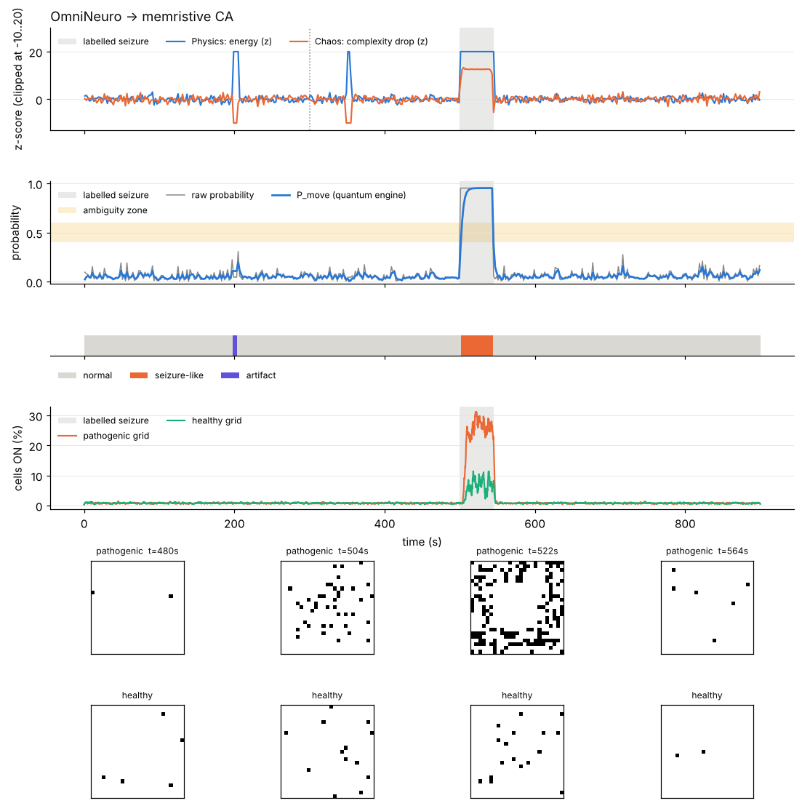

# Epilepsy Seizure Detection Prototype (OmniNeuro + memristive cellular automaton)

**Built with Claude.** All code in this repository was written by Claude (Anthropic) from my own research idea document. I chose the research question, directed the design, ran every test on my own computer, downloaded the data, and recorded the results. I do not claim to understand every line of the code, but I am actively working on it.

**This is a research prototype, not a medical device. It must not be used for any medical or clinical decision.**

## The idea
Combine OmniNeuro's explainable EEG engines (signal energy, Higuchi fractal dimension as a measure of signal complexity, and a quantum-inspired probability state) with a memristive cellular-automaton model of epileptic activity. Hypothesis: during a seizure, energy goes up and complexity goes down.

## What I did
1. Wrote the idea document, then had Claude build the pipeline from it.
2. Tested it on synthetic EEG (25 automated tests pass).
3. Ran it on real recordings from patient chb01 of the CHB-MIT Scalp EEG Database (PhysioNet), using two channels (F3-C3, F4-C4).
4. Compared the energy engine, the complexity engine and both fused, using AUC.
5. Wrote the final test plan down before running it, then ran two designs once on seizure files nobody had looked at.

## Results (one patient, very small sample)
- The energy rise separated seizure windows from normal windows well (AUC 0.92-1.00 on the files I examined).
- The complexity drop was weak and inconsistent (AUC 0.51-0.77), so the hypothesis is only half supported.
- Final test on 3 untouched seizures: the original two-engine design detected 0 of 3. Energy alone detected 2 of 3, with 4 short false-alarm episodes in 3.3 hours.
- Three seizures from one patient cannot show that this works in general.

Full details, mistakes and limitations: `docs/HONEST_LIMITS.md`.

## Run it
    pip install -r requirements.txt
    python -m omnineuro demo
    python tests/run_tests.py

## Credits
OmniNeuro framework (Ayda Aghaei Nia); memristive cellular-automaton model of epilepsy (Karamani et al.); data: CHB-MIT Scalp EEG Database, PhysioNet (Shoeb, 2009). The data are not included in this repository.


# OmniNeuro → memristive Cellular Automaton

EEG → three explainable "engines" (Physics, Chaos, Quantum-inspired) → safety protocol → a two-grid
**memristive cellular automaton** that shows a seizure-like state spreading from a pathogenic grid into a
healthy one. Sound, a Bloch-sphere picture and a cautious text report come out of the same decision.



*(Synthetic EEG demo. The seizure at 500-545 s is detected 4 s after onset; the movement artifact at 200 s is
rejected; the muscle burst at 350 s is ignored because only one engine reacts.)*

## Quick start
```
pip install numpy scipy matplotlib
python -m omnineuro demo                  # synthetic EEG, writes ./outputs/
python tests/run_tests.py                 # 25 checks
python scripts/ablation.py                # does each component help? (synthetic)
python -m omnineuro run data/chb01_03.edf --summary data/chb01-summary.txt     # real CHB-MIT file
```

## Where to start reading
1. **`docs/GUIDE.md`**: learn Python-for-this-project and every part, step by step, with checks.
2. **`steps/`**: six small scripts, one per component, each producing a picture.
3. **`docs/HONEST_LIMITS.md`**: what is and is not validated. Read it before trusting any number.

## Layout
```
omnineuro/
  config.py      every tunable number
  data.py        synthetic EEG, CHB-MIT loading (own EDF reader), seizure-time parsing
  engines.py     Physics (energy, Lidx), Chaos (Higuchi FD), phase sync, z-scores, fusion vote
  quantum.py     Bloch-sphere engine, P_move = sin²(θ/2)
  safety.py      artifact rules, ambiguity zone 0.4-0.6
  memristor.py   software memristor (read / write phases)
  ca.py          two-grid memristive CA, driven by an epilepsy level s in [0, 1]
  pipeline.py    analyse() and evaluate()
  outputs.py     dashboard, Bloch sphere, sonification (Table 1), report
steps/  tests/  scripts/  docs/  data/  outputs/
```

## Status
Research prototype. Works on synthetic EEG. **First real-data runs (CHB-MIT chb01) were poor**: the seizure was missed with default settings and one seizure-free hour produced false alarms from slow drift. Details, and what was changed in response, are in `docs/HONEST_LIMITS.md` section 7.
Not a medical device. Not included: the motor-imagery (PhysioNet) branch of the original OmniNeuro paper.
